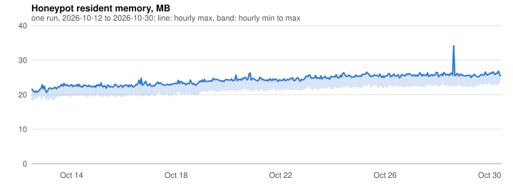

# Gem

A small dynamic language with Erlang-style processes that compiles to C. I wrote it for small networked services: request handlers, message brokers, supervised long-running processes, without a VM or a runtime bigger than the program.

```gem
let pid = spawn() do
  receive
  when {from: p, msg: m}
    send(p, "echo: {m}")
  end
end

send(pid, {from: self(), msg: "hi"})
print(receive())   # -> echo: hi
```

The syntax is Ruby-ish (`do/end`, blocks as a trailing argument), the data model is Lua-ish (tables for objects, dicts, arrays and modules), and the concurrency is Erlang's: processes, mailboxes, monitors, links, supervisors. The compiler is written in Gem and emits C. The runtime vendors `minicoro` for stackful coroutines and `stb_ds` for hash maps. `bootstrap/stage0.c` is the compiler's own C output, checked in, so any C compiler can build it from scratch.

A process is a green thread with its own heap and mailbox, cheap enough to start one per connection. Processes share nothing and talk only by message.

All processes run on one OS thread. A process runs until it waits (`receive`, a socket, `sleep`) or has used up its slice. The slice is counted at loop back-edges, tail-recursive loops included, so a deep non-tail recursion keeps the others waiting until it returns. Reading and writing files, `exec`, opening SQLite and `extern blocking fn` calls go to a small thread pool (four threads by default) and the other processes keep running meanwhile; SQLite queries and reading stdin run on the scheduler thread. Gem code itself never runs on more than one core.

## Memory model

- Inside a process, tables are references. `let b = a` and passing `a` to a function share the same table, as in Lua or JavaScript. Strings and numbers are values.
- Between processes, everything is copied. `send` deep-copies the message into the receiver's heap, and `spawn` copies what the new process captures and the module-level state. There is no shared memory and no locking.
- There is no tracing GC. Each process allocates from its own arena, freed in one go when the process exits. For long-running processes the compiler inserts a reset at the back-edge of every loop and self tail call: liveness analysis decides what the loop still uses, and the runtime copies that and frees the rest. A recursive function's return frees what its call allocated the same way. A `while true` accept loop runs in constant memory with no annotation.
- The costs are visible. A message costs a copy proportional to its size, and a loop reset costs time proportional to what the loop keeps. A reset runs on the scheduler thread, so every other process waits while it copies: a loop that keeps a large table across iterations pauses the program now and then. A loop the compiler can't reset keeps what it allocates until it ends, and for a `while true` loop the compiler warns.

The [telnet honeypot](examples/honeypot/) ran on the open internet for 18 days without a restart and took 3.5 million sessions from about 2,400 IP addresses and 17 million shell commands, with no reset over 10 ms. Its resident memory (the run's data isn't in this repository):



The low point rose about 4 MB over the run while sessions per day more than doubled. About 2 MB of that was garbage in the arenas of the six long-lived processes: the build that ran reset a loop only once it had allocated 1 MB, and a process that does a little work now and then took days to get there. A loop in a process that waits (in `receive`, `sleep` or on a socket) resets after 64 KB. I haven't traced the rest.

[mini_redis](examples/mini_redis/) is the other long-lived example: a keyspace held in one process's loop, a process per connection and pub/sub fan-out.

## OTP in plain Gem

`gen_server`, `supervisor`, `dynamic_supervisor` and `task` are ordinary Gem modules built on `spawn`, selective `receive` and tail-recursive loops. The compiler knows nothing about them.

```gem
load "std/gen_server"

let counter = {
  init: fn() {state: 0} end,
  handle_call: fn(msg, from, state)
    match msg
    when "get"
      {reply: state, state: state}
    when "inc"
      {reply: state + 1, state: state + 1}
    end
  end,
  handle_cast: fn(msg, state) {state: state} end,
  handle_info: fn(msg, state) {state: state} end
}

let {pid} = gen_server.start(counter)
gen_server.call(pid, "inc")    # 1
gen_server.call(pid, "inc")    # 2
```

The standard library is in `std/`, written in Gem: strings, tables, JSON (passes all 283 required cases of JSONTestSuite), regex, CSV, an HTTP server and client (`https://` included), SQLite, the OTP modules above, a test runner and a few more. [docs/CHEATSHEET.md](docs/CHEATSHEET.md) lists them all, with the syntax and builtins.

## Performance

The larger examples have twins in other languages under `benchmarks/`, and `benchmarks/measure_all.sh` runs them all. On an M1 Pro (macOS, CPython 3.14, Node 25, Redis 8, Elixir 1.20 on OTP 29):

| Program | Compared with | Gem |
|---|---|---|
| [lox](examples/lox/), a tree-walking interpreter, 6 programs | the same interpreter in Python | 0.41 to 0.64× Python's time; 4 to 28 MB against Python's 21 to 24 |
| [logstat](examples/logstat/), an access-log report | the same program in Python | 0.81 to 0.87× Python's time |
| [mini_redis](examples/mini_redis/) | `redis-server`, `redis-benchmark` | 0.3 to 1.2× Redis's requests/s, 0.25 to 0.8× pipelined; pub/sub to 100 subscribers 0.02× |
| [jobqueue](examples/jobqueue/), 6 load and fault scenarios | the same tree in Elixir/OTP | 0.84 to 1.22× Elixir's jobs/s; 54 to 390 MB against 126 to 247 |
| [bookmark_app](examples/bookmark_app/) | the same app in Node | 0.6 to 0.7× Node's requests/s on SQLite pages, 1.3× on a static one; 23 MB peak against 307 |
| [gemgrep](examples/gemgrep/) | GNU grep, Python | 1.4 to 16× grep's time, 0.5 to 2.4× Python's |

On searches with few matches, gemgrep spends most of its time in libc's `regexec`, which on macOS is slower than Python's `re`, and GNU grep searches for the pattern's literal parts instead of running a regex on every line. Pub/sub in mini_redis writes each message to each subscriber's socket separately, where Redis batches them.

## What Gem is not

It isn't a general-purpose language. It's good at protocol parsing, request handling and supervised long-running processes, and not aimed at numeric work or systems programming.

It isn't production software. There has been no security audit, there's no promise of backwards compatibility, and the HTTP server has no TLS (put a reverse proxy in front).

It's a personal project. Issues and PRs are welcome, but I answer when I have time.

## Build and run

You need a C compiler and `make`. Gem builds on macOS and Linux (arm64 and x86_64); `https://` needs OpenSSL 3.

```sh
make build      # build/gem from bootstrap/stage0.c
make test       # the test suite
make bootstrap  # regenerate stage0.c from the compiler sources

build/gem examples/01_basics.gem            # compile and run
build/gem examples/01_basics.gem -o hello   # compile only
build/gem examples/01_basics.gem --emit-c   # print the generated C
build/gem examples/01_basics.gem --check    # parse and analyze only
```

`make install PREFIX=$HOME/.local` puts `gem` in `$PREFIX/bin`. If you'd rather run it from the checkout, symlink `build/gem` onto your `PATH`: it finds `std/` and `runtime/` two directories above its real path.

`gem new demo` makes a project with a `gem.toml`, `main.gem` and `test.gem`; `gem test` and `gem build` work inside it.

## Layout

- `compiler/`: the self-hosting compiler.
- `runtime/`: the C runtime (scheduler, arenas, builtins, vendored libraries).
- `std/`: the standard library.
- `lsp/`: the language server, run as `gem lsp`.
- `examples/`: numbered test programs, plus larger ones: a JSON parser, a TCP echo server, a bookmark web app on SQLite (`bookmark_app/`), a STOMP broker (`stomp_broker/`), an access-log analyzer (`logstat/`), a Redis-protocol server (`mini_redis/`), a Lox interpreter (`lox/`), a grep on libc's regex (`gemgrep/`), a job queue under fault injection (`jobqueue/`), a telnet honeypot (`honeypot/`) and a small website that records its traffic (`httpd/`).
- `benchmarks/`: harnesses that compare the example programs with Python, Node, Redis, GNU grep and Elixir.
- `editors/`: a VS Code grammar and a tree-sitter grammar for Helix.

## Status

Pre-1.0. The memory model, the concurrency primitives and the syntax are stable. The standard library will grow, and its functions may still change before 1.0.
